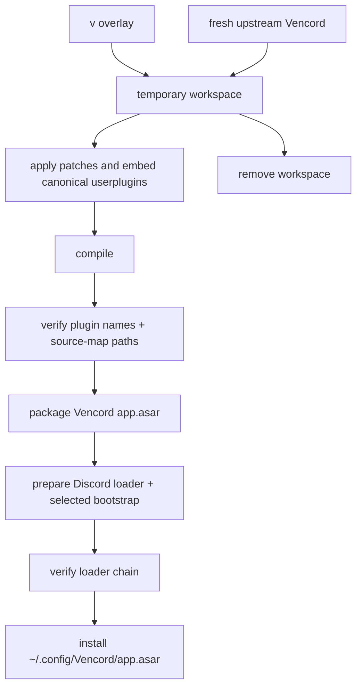

<p align="center">
  <picture>
    <source media="(prefers-color-scheme: dark)" srcset="../site/brand/v-logo.svg">
    <source media="(prefers-color-scheme: light)" srcset="../site/brand/v-logo-light.svg">
    
  </picture>
</p>

# v

A source overlay for [Vencord](https://github.com/Vendicated/Vencord). It builds against a fresh upstream checkout and installs one persistent compiled runtime: `~/.config/Vencord/app.asar`.

> [!WARNING]
> **Disclaimer**
>
> - **Not affiliated** with Discord, Vencord or OpenAsar, and not endorsed by them.
> - **Client modifications are against Discord's Terms of Service.** That includes Vencord itself. Using them can get your Discord account limited or banned; you use them at your own risk.
> - **This is not a replacement for Vencord.** Vencord Forge and the installer only download the official Vencord and OpenAsar, apply this project's patches and plugins, and install the result. Problems with Discord or Vencord themselves belong to those projects.
> - **No warranty, no liability.** This software is provided as is, without warranty of any kind (GPL-3.0, sections 15 and 16). The authors take no responsibility for any damage, data loss, account action or other consequence of using it.

There is no Vencord fork, persistent upstream checkout or committed build output. Vencord Forge (below) is the optional app that does the same as the installer with a window.

<!-- DEMO-START -->
<p align="center"><strong>▶ <a href="https://darkphilosophy.github.io/v/screenshots/demo.webm">Watch the demo</a></strong></p>

   
<!-- DEMO-END -->

## Included customizations

Custom plugins (each can be turned off in Forge or the profile):

<!-- PLUGINS-START -->
- **PerfMonitor** — Warns when Discord stalls and shows whether plugins, themes or Discord caused it.
- **PlatformSpoofer** — Appear as Desktop, Mobile, Web or Console. Switch from the status menu.
- **PooWangUploader** — Send attachments through poo.wang with retention-controlled links instead of storing them on Discord.
- **PrivacyPruner** — Deletes your expired messages per channel retention policy, keeping messages marked Keep.
- **QuestCompleter** — Completes enrolled Discord quests without installing the advertised game.
- **SteamRichPresence** — Shows the Steam game you are playing, including Proton games.
<!-- PLUGINS-END -->

Built in:

- **User Plugin Manager** — transactionally installs and updates custom user plugins from Discord settings.
- **Translate** — custom translation integration (full overlay copy of the stock plugin).
- **OpenAsar** — installed or updated by default as Discord's optimized bootstrap, with Linux-safe runtime patches and Vencord's loader preserved.

Patches to Vencord, applied in this order:

<!-- PATCHES-START -->
| Patch | What it does | |
|---|---|---|
| **Custom updater** (`update.patch`) | In-app updater that rebuilds this distribution and keeps your selection. | required |
| **User Plugin Manager** (`userplugin-manager.patch`) | Installs and updates custom plugins from Discord settings. | required |
| **NoTrack hardening** (`runtime-noise.patch`) | Keeps analytics and Sentry off without failed sentry-ipc requests. | optional |
| **Cloud sync fix** (`cloudsync.patch`) | Fixes Vencord cloud settings sync. | optional |
| **HideMedia auto-hide** (`hide-media.patch`) | Media is not loaded until you click it. | optional |
| **Performance attribution** (`perf-attribution.patch`) | Times plugin renders and event handlers for PerfMonitor. | optional |
| **Fast startup patching** (`webpack-fast-patching.patch`) | Skips modules no plugin patches and compiles each patched module once. | optional |
<!-- PATCHES-END -->

### PooWangUploader

**PooWangUploader** hooks normal chat attachments from the file picker, paste, and drag-and-drop. Its per-upload dialog provides a **Reroute upload through poo.wang** checkbox; selected files are sent through `POST https://poo.wang/api/upload` and replaced with the returned `/f/{id}` links without changing existing message text.

- Configure a registered-account machine access token from **Settings → Plugins → PooWangUploader**. Anonymous uploads are intentionally not used. The token is encrypted with Electron `safeStorage`; it is never written to Vencord settings or Settings Sync.
- The plus attachment button is hooked at runtime: left click opens the native poo.wang file picker; right click remains Discord's original upload menu. A separate poo.wang upload icon is also added to the chat bar. Without a configured token, either poo.wang action opens the in-chat token configuration modal.
- Drag-and-drop, paste, and other file-picker paths still show the per-upload reroute checkbox. Choose whether it starts enabled, or disable the dialog and select a default destination.
- Oversized files can bypass Discord automatically at a configurable MB threshold and use poo.wang before Discord rejects them.
- Select burn-after-read, 1 hour, 24 hours, 7 days (default), 30 days, or permanent retention where the poo.wang account policy permits it.
- Optional random filenames preserve the original extension while using a configurable length and safe ASCII character set.
- A byte-progress modal shows the active filename, file number, and percentage. If an external upload fails, successful links remain and the failed plus remaining files are restored to the Discord composer for retry; they are not sent automatically.
- Thumbnail/internal upload paths are excluded. Disabling the plugin restores Discord's native uploader.

### PrivacyPruner

**PrivacyPruner** applies independent retention policies to messages authored by the current user. Configure it from **Settings → Plugins → PrivacyPruner**, the privacy button in the chat bar, or a channel context menu.

- A channel must have an enabled policy before pruning starts; automatic application to new guilds, DMs, and group DMs is opt-in.
- Set retention, maximum lookback, scan interval, and whether thread messages are included. The built-in template defaults to 1 day retention, 1 year maximum lookback, a 2-hour scan interval, and thread inclusion.
- Use **Preview** before deletion and mark individual messages **Keep** from the message menu. Kept messages are excluded from future pruning.
- Deletion is limited to your own eligible messages and is irreversible; existing policies are not changed when defaults are edited.

## Vencord Forge (app)

Changelog: [CHANGELOG.md](CHANGELOG.md).

A desktop app (Linux and Windows) that does what the installer does (started with arguments, `vencord-forge` is also its command line) and let you choose what goes in:

- **Discord:** detects Stable, PTB, Canary and Development (native, Flatpak, Windows `%LOCALAPPDATA%`; macOS paths are included but untested); any other folder can be added by hand.
- **Plugins:** turn any custom plugin off; it is not built in.
- **Patches:** optional patches can be turned off; required ones (updater, plugin manager) stay on.
- **OpenAsar:** install/update, keep, or remove (the original Discord bootstrap is backed up and restored).
- **Restore stock Discord** in one click.

It needs nothing preinstalled: if Node.js 22+ is missing it downloads the official build (checksum verified), and it runs the exact pnpm version Vencord pins. Everything it downloads or builds stays under the user's cache directory.

The selection is saved as `forge-profile.json` next to the runtime and is honored by `./i`, the uupd hook and the in-app updater, so turned-off plugins and patches stay off across every kind of update. The in-app updater no longer needs `python3`, `sh`, `curl` or `tar`, so it works on Windows too (it still needs `git`, `node` and `pnpm`).

Forge is distribution-agnostic: what it builds is described by [`forge.json`](../forge.json) (upstream repository, overlay, patch metadata, plugin descriptions, OpenAsar fixes). Point it at another overlay with a `forge.json` and it builds that instead.

```sh
cd forge && cargo build --release
./target/release/vencord-forge            # the app (registers itself in the app menu on Linux)
./target/release/vencord-forge detect            # installations found
./target/release/vencord-forge list --source ..  # plugins and patches
./target/release/vencord-forge install --source .. --disable-plugin steamRichPresence
```

<!-- LATEST-START -->
<details open>
<summary><strong>Latest update (0.1.2 · Fewer sandbox permissions, 2026-10-22)</strong></summary>

- The Flatpak no longer needs access to `~/.config/Vencord`: the runtime and the saved selection are written by Forge's helper on the host.
- A failed install restores the previous runtime in every packaging, including Flatpak.
- The host helper also starts on ARM (aarch64) systems.

</details>
<!-- LATEST-END -->

<!-- FORGE-START -->
Latest app version: **0.1.2** — [download for Linux and Windows](https://github.com/DarkPhilosophy/v/releases/tag/forge-v0.1.2) · [all releases](https://github.com/DarkPhilosophy/v/releases)
<!-- FORGE-END -->

Every version bump of Forge is built for Linux and Windows and published as a release automatically. [`forge/tests/equivalence.sh`](../forge/tests/equivalence.sh) proves the Rust engine produces byte-identical results to the shell installer's tools (patches, runtime ASAR, loader, embedded seeds, OpenAsar fixes).

Brand and icon studio: <https://darkphilosophy.github.io/v/brand/>.

## Install

```sh
curl -fsL https://darkphilosophy.github.io/v/i|sh
```

Requirements: `git`, `node`, `pnpm` (or Corepack), `curl`, `tar`, `python3`, and permission to update Discord's `app.asar`. The installer may request `sudo` only when the Discord resources directory is not user-writable.

The installer:

1. downloads this overlay when it is not run from a local checkout;
2. clones a fresh upstream Vencord checkout into a temporary directory;
3. overlays the canonical `core/src/` tree and applies the custom patches;
4. lists every custom plugin discovered under `core/src/userplugins/`;
5. installs build dependencies and compiles only inside the temporary checkout;
6. verifies every listed plugin name in the renderer bundle and its exact source path in the renderer source map;
7. packages the verified runtime for `~/.config/Vencord/app.asar`;
8. installs or updates OpenAsar by default, preserving the original Discord bootstrap as `resources/app.asar.backup`;
9. installs the Vencord loader as `resources/app.asar` and keeps the selected bootstrap at `resources/_app.asar`;
10. verifies the complete loader → Vencord runtime → OpenAsar/original bootstrap chain;
11. removes temporary source, dependencies, patches, and build output.

Existing Vencord settings are preserved. No persistent `dist/`, `node_modules/`, cloned Vencord source, or `userPluginSeeds/` directory is required.

### Discord installation detection

The installer detects Stable, PTB, Canary, and Development builds installed natively, by Discord's self-updater, or through system/user Flatpak. If more than one installation is found, select one explicitly:

```sh
VENCORD_DISCORD_DIR=/path/to/discord-or-resources ./i
```

System-Electron package layouts are detected but rejected because safely managing their paired `app.asar.unpacked` tree is not yet supported.

### OpenAsar choices

OpenAsar uses the official nightly artifact also used by the Vencord installer. The default is `install`, including for non-interactive installs.

Before installation, the downloaded ASAR is patched in place without cloning or building OpenAsar. The patch keeps the `perf` preset and its other optimizations, but omits `EnableDrDc` on Linux because that forced feature crashes Discord's GPU subprocess on Wayland and triggers software-rendering fallback, video frame drops, and black flicker. Non-Linux behavior is unchanged. The existing Flatpak module-update correction is applied in the same validated transaction.

Both transformations use exact source signatures and fail closed when OpenAsar changes upstream. The rewritten ASAR is reparsed, its integrity metadata is regenerated, and both patches are verified before Discord's active bootstrap is replaced.

```sh
# Install or update OpenAsar (default)
OPENASAR_ACTION=install ./i

# Preserve the current OpenAsar/original Discord bootstrap state
OPENASAR_ACTION=keep ./i

# Remove OpenAsar and restore the preserved original Discord bootstrap
OPENASAR_ACTION=remove ./i
```

Interactive runs accept `install`, `keep`, or `remove`. The source URL can be overridden for controlled testing:

```sh
OPENASAR_URL=https://example.invalid/app.asar ./i
```

The candidate is parsed and validated as OpenAsar before Discord files are changed. Installation is fail-closed and uses sibling temporary files plus atomic replacement. `remove` refuses to proceed when a valid original backup is unavailable.

After installation, the Discord resources layout is:

```text
Discord/resources/
├── app.asar          # small Vencord loader
├── _app.asar         # OpenAsar by default, or Discord's original bootstrap
└── app.asar.backup   # preserved original while OpenAsar is installed

~/.config/Vencord/
└── app.asar          # compiled custom Vencord runtime
```

## Updating

In Discord, open:

**Settings → Vencord → Updater → Check for updates**

The updater performs the same temporary clean build, plugin verification, and atomic runtime replacement. OpenAsar lifecycle selection remains an installer concern; Vencord updates preserve the current bootstrap state.

## Repository layout

```text
v/
├── core/src/
│   ├── userplugins/                  # canonical custom plugin sources
│   │   ├── platformSpoofer/
│   │   ├── pooWangUploader/
│   │   ├── privacyPruner/
│   │   ├── perfMonitor/
│   │   ├── questCompleter/
│   │   └── steamRichPresence/
│   ├── api/PerfAttribution.ts        # per-plugin render/flux timing used by PerfMonitor
│   ├── main/userPluginManager/       # manager host implementation
│   ├── components/                   # Vencord settings integration
│   └── shared/                       # shared manager contracts
├── patches/
│   └── *.patch, series               # see the Patches table above (generated from forge.json)
├── forge/                          # Vencord Forge: Rust engine (core), command line (cli), app (gui)
├── forge.json                      # distribution manifest read by Forge and the updaters
├── site/brand/                     # icon and logo studio (GitHub Pages)
├── scripts/
│   ├── choose-openasar-action.sh
│   ├── manage-openasar.py
│   ├── package-vencord-asar.sh
│   ├── stage-userplugin-seeds.sh
│   └── verify-userplugins-build.py
├── tests/
│   ├── userPluginManager/
│   ├── choose-openasar-action.sh
│   ├── manage-openasar.sh
│   ├── package-vencord-asar.sh
│   ├── privacyPruner.test.ts
│   ├── questCompleter.test.ts
│   ├── steamRichPresence.test.ts
│   └── verify-userplugins-build.sh
└── i
```

`core/src/` is the single canonical source overlay copied into each temporary upstream checkout. Custom plugins live directly under `core/src/userplugins/`; there is no second source tree to synchronize. Generated `core/dist/userPluginSeeds/` output is obsolete and must not be retained or packaged.

## Build flow



## Verification

Focused local checks:

```sh
pnpm dlx tsx --test tests/pooWangUploader.test.ts
pnpm dlx tsx --test tests/privacyPruner.test.ts
pnpm dlx tsx --test tests/questCompleter.test.ts
pnpm dlx tsx --test tests/steamRichPresence.test.ts
sh tests/verify-userplugins-build.sh
sh tests/package-vencord-asar.sh
sh tests/choose-openasar-action.sh
sh tests/manage-openasar.sh
```

The complete install/build path is exercised by running `./i` from the repository root. A real Discord restart is required to load a newly installed runtime or bootstrap.

## License

This project is licensed under GPL-3.0-or-later; see [`LICENSE`](../LICENSE). It builds on and ships with the components below; [`THIRD_PARTY_NOTICES.md`](THIRD_PARTY_NOTICES.md) has the details and every Rust crate with its license.

<!-- LICENSES-START -->
| Component | How it is used | License |
|---|---|---|
| This project (overlay, custom plugins, patches, installer, Forge) | source in this repository | GPL-3.0-or-later |
| [Vencord](https://github.com/Vendicated/Vencord) | downloaded and built at install time | GPL-3.0-or-later |
| [OpenAsar](https://github.com/GooseMod/OpenAsar) | downloaded at install time (optional) | AGPL-3.0 |
| [CreArts v3 (repatched)](https://github.com/CreArts-Community/CreArts-Discord) by Daniel Klingel / CreArts-Community; fixes by DarkPhilosophy | bundled in `themes/` | MIT |
| [Node.js](https://nodejs.org) and [pnpm](https://pnpm.io) | downloaded by Forge to build Vencord when missing | MIT |
| 420 Rust crates, including the Ubuntu font egui embeds | compiled into the Vencord Forge binaries | permissive (MIT, Apache-2.0, BSD, Zlib, ISC, Unicode, OFL/UFL, …); full list in THIRD_PARTY_NOTICES |
<!-- LICENSES-END -->
